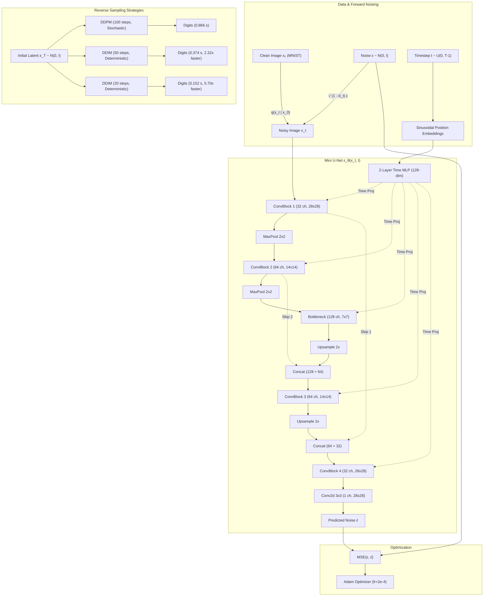
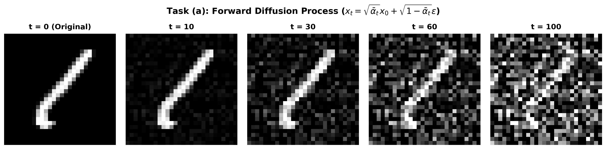
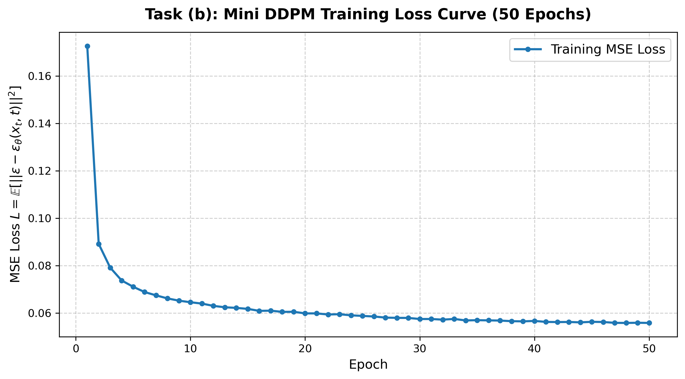
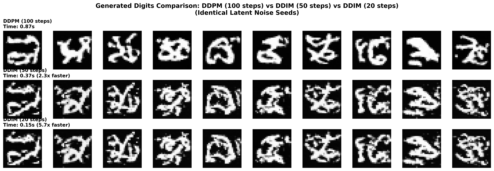
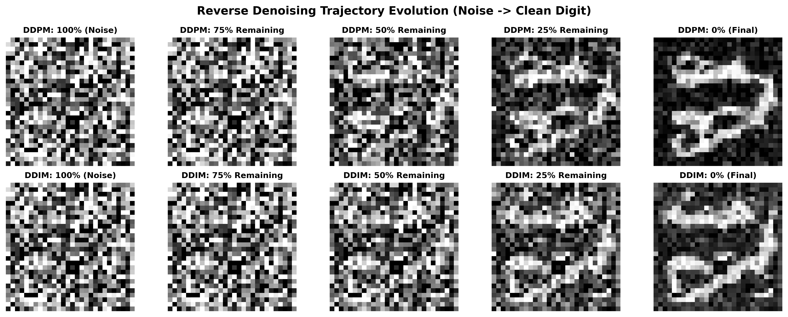
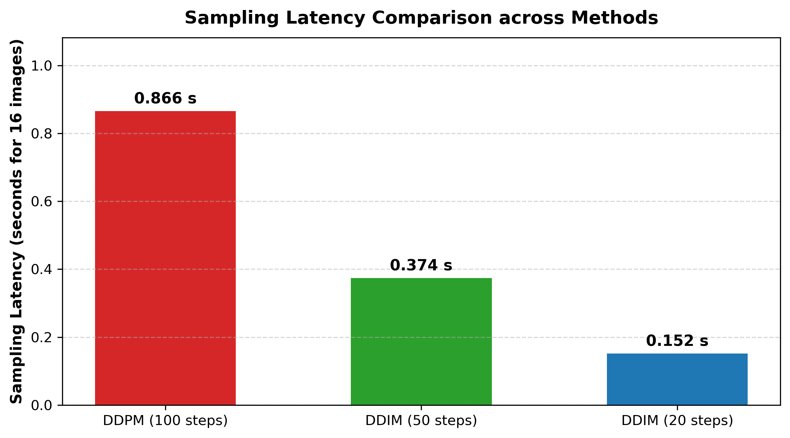

# Mini Diffusion Model (DDPM $\to$ DDIM)

[](https://www.python.org/)
[](https://pytorch.org/)
[-76b900.svg)](https://developer.nvidia.com/cuda-toolkit)
[](https://en.wikipedia.org/wiki/MNIST_database)
[](mini_diffusion_ddpm_ddim.ipynb)

This repository contains the complete modular implementation, trained weights, quantitative CSV/JSON metrics, and comparative evaluation for **Homework 8: Mini Diffusion Model (DDPM $\to$ DDIM)** for **DATA 266: Generative AI** at San José State University (SJSU).

The project implements a simplified diffusion model inspired by the landmark **DDPM** paper (*Denoising Diffusion Probabilistic Models*, Ho et al., 2020) and modifies its reverse sampling procedure to reproduce **DDIM** (*Denoising Diffusion Implicit Models*, Song et al., 2020). Using the MNIST handwritten digit dataset, we train a multi-layer convolutional noise-prediction network with sinusoidal timestep conditioning, evaluate the forward noising process, and benchmark reverse sampling quality and speed across **DDPM (100 steps)**, **DDIM (50 steps)**, and **DDIM (20 steps)** using matched latent noise seeds.

---

## Table of Contents
1. [Assignment Specifications & Configuration](#assignment-specifications--configuration)
2. [Modular Codebase Structure](#modular-codebase-structure)
3. [Mathematical Formulation](#mathematical-formulation)
   - [Forward Diffusion Process (DDPM)](#1-forward-diffusion-process-ddpm)
   - [Reverse Process & Training Loss (DDPM)](#2-reverse-process--training-loss-ddpm)
   - [Accelerated Sampling Formulation (DDIM)](#3-accelerated-sampling-formulation-ddim)
4. [System Architecture](#system-architecture)
   - [End-to-End Pipeline Diagram](#end-to-end-pipeline-diagram)
   - [Mini U-Net Noise Predictor Architecture](#mini-u-net-noise-predictor-architecture)
5. [Task (a): Forward Diffusion Process & Visualization](#task-a-forward-diffusion-process--visualization)
6. [Task (b): Mini DDPM Training & Convergence](#task-b-mini-ddpm-training--convergence)
7. [Tasks (c) & (d): Comparative Sampling (DDPM vs. DDIM)](#tasks-c--d-comparative-sampling-ddpm-vs-ddim)
   - [Visual Comparison with Identical Latent Seeds](#visual-comparison-with-identical-latent-seeds)
   - [Reverse Denoising Progression Trajectories](#reverse-denoising-progression-trajectories)
   - [Latency & Speedup Benchmarks](#latency--speedup-benchmarks)
8. [Structured Quantitative Results (CSV & JSON)](#structured-quantitative-results-csv--json)
9. [In-Depth Discussion of Differences](#in-depth-discussion-of-differences)
10. [How to Run and Reproduce](#how-to-run-and-reproduce)
11. [References](#references)

---

## Assignment Specifications & Configuration

| Parameter / Requirement | Specification | Implementation Details |
| :--- | :--- | :--- |
| **Diffusion Steps** | $T = 100$ | Discrete timesteps $t \in \{0, 1, \dots, 99\}$ |
| **Noise Schedule** | $\beta_t$ linearly increasing from $0.0001$ to $0.02$ | Precomputed $\beta_t$, $\alpha_t = 1 - \beta_t$, $\bar{\alpha}_t = \prod_{s=1}^t \alpha_s$ |
| **Training Budget** | Batch size $128$, Epochs $50$ | 50 epochs over 60,000 MNIST training images (468 batches/epoch) |
| **CNN Architecture** | $\ge 4$ conv layers, ReLU activations, time conditioned, same shape output | 10-layer Mini U-Net with skip connections, sinusoidal time embeddings, and GroupNorm (546,817 parameters) |
| **Loss Function** | $L = \text{MSE}(\epsilon, \epsilon_\theta(x_t, t))$ | Mean Squared Error between true Gaussian noise and predicted noise |
| **Sampling Targets** | DDPM (100 steps), DDIM (50 steps), DDIM (20 steps) | Side-by-side reconstruction starting from identical latent seeds $x_T$ |
| **Primary Deliverables**| Executed Notebook + Visualizations + Discussion | [`mini_diffusion_ddpm_ddim.ipynb`](mini_diffusion_ddpm_ddim.ipynb) |

---

## Modular Codebase Structure

Instead of dumping all logic into a monolithic script, the codebase is decomposed into dedicated, testable modules:

```
Assignment8/
├── Question.pdf                     # Original assignment specification
├── README.md                        # Project documentation, diagrams, charts & analysis
├── scheduler.py                     # Linear noise schedule & forward closed-form sampling
├── dataset.py                       # MNIST DataLoader pipeline normalized to [-1, 1]
├── model.py                         # 10-layer Mini U-Net noise predictor architecture
├── sampler.py                       # DDPM (100 steps) & DDIM (50/20 steps) sampling routines
├── train_and_evaluate.py            # Pipeline orchestrating training and benchmarks
├── build_notebook.py                # Script compiling the executed Jupyter Notebook
├── mini_diffusion_ddpm_ddim.ipynb   # Complete executed notebook with embedded outputs
├── mini_ddpm_mnist.pt               # Trained PyTorch checkpoint (50 epochs)
├── training_loss.csv                # Epoch-by-epoch MSE training loss
├── sampling_benchmarks.csv          # Sampling latency, throughput & speedup table
├── sampling_benchmarks.json         # Structured benchmark metrics in JSON format
├── forward_diffusion_vis.png        # Task (a) visualization (t = 0, 10, 30, 60, 100)
├── training_loss.png                # Task (b) 50-epoch loss curve plot
├── ddpm_vs_ddim_samples.png         # Task (c & d) side-by-side digit comparison grid
├── reverse_trajectories.png         # Denoising evolution from noise to clean digit
├── speed_comparison.png             # Sampling latency comparison bar chart
└── data/                            # Local MNIST dataset cache
```

---

## Mathematical Formulation

### 1. Forward Diffusion Process (DDPM)
The forward diffusion process progressively injects Gaussian noise into a clean image $x_0 \sim q(x_0)$ over $T$ timesteps according to variance schedule $\beta_1, \beta_2, \dots, \beta_T$:

$$q(x_t | x_{t-1}) = \mathcal{N}(x_t; \sqrt{1 - \beta_t} x_{t-1}, \beta_t \mathbf{I})$$

Defining $\alpha_t = 1 - \beta_t$ and the cumulative product $\bar{\alpha}_t = \prod_{s=1}^t \alpha_s$, we can jump directly from $x_0$ to any arbitrary timestep $t$ in closed form via the reparameterization trick:

$$x_t = \sqrt{\bar{\alpha}_t} x_0 + \sqrt{1 - \bar{\alpha}_t} \epsilon, \quad \epsilon \sim \mathcal{N}(0, \mathbf{I})$$

As $t \to T$, $\bar{\alpha}_T \to 0$, causing $x_T$ to converge to an isotropic Gaussian distribution: $x_T \sim \mathcal{N}(0, \mathbf{I})$.

### 2. Reverse Process & Training Loss (DDPM)
The reverse process is modeled as a parameterized Markov chain:

$$p_\theta(x_{t-1} | x_t) = \mathcal{N}(x_{t-1}; \mu_\theta(x_t, t), \sigma_t^2 \mathbf{I})$$

Ho et al. showed that reparameterizing the model to predict the added noise $\epsilon$ optimizes the variational lower bound effectively:

$$\mathcal{L}_{\text{simple}}(\theta) = \mathbb{E}_{t \sim \mathcal{U}(1, T), x_0 \sim q(x_0), \epsilon \sim \mathcal{N}(0, \mathbf{I})} \left[ \|\epsilon - \epsilon_\theta(x_t, t)\|^2 \right]$$

During reverse sampling ($t = T, \dots, 1$):

$$x_{t-1} = \frac{1}{\sqrt{\alpha_t}} \left( x_t - \frac{1 - \alpha_t}{\sqrt{1 - \bar{\alpha}_t}} \epsilon_\theta(x_t, t) \right) + \sigma_t z$$

where $z \sim \mathcal{N}(0, \mathbf{I})$ if $t > 1$ and $z = 0$ at $t = 1$. The variance term is:

$$\sigma_t^2 = \tilde{\beta}_t = \frac{1 - \bar{\alpha}_{t-1}}{1 - \bar{\alpha}_t} \beta_t$$

### 3. Accelerated Sampling Formulation (DDIM)
DDIM (Song et al., 2020) defines a non-Markovian forward process sharing the identical marginals $q(x_t | x_0)$ as DDPM, but altering the joint distributions. This allows sampling over an arbitrary sub-sequence of timesteps $\tau = [\tau_1, \tau_2, \dots, \tau_S]$ with $S < T$.

For each step from $\tau_i$ down to $\tau_{i-1}$:
1. **Estimate clean $x_0$:**
   $$\hat{x}_0 = \frac{x_{\tau_i} - \sqrt{1 - \bar{\alpha}_{\tau_i}} \epsilon_\theta(x_{\tau_i}, \tau_i)}{\sqrt{\bar{\alpha}_{\tau_i}}}$$
2. **Compute stochastic variance $\sigma_{\tau_i}$:**
   $$\sigma_{\tau_i} = \eta \sqrt{\frac{1 - \bar{\alpha}_{\tau_{i-1}}}{1 - \bar{\alpha}_{\tau_i}}} \sqrt{1 - \frac{\bar{\alpha}_{\tau_i}}{\bar{\alpha}_{\tau_{i-1}}}}$$
   Setting $\eta = 0$ makes the process **completely deterministic** ($\sigma_{\tau_i} = 0$).
3. **Compute $x_{\tau_{i-1}}$:**
   $$x_{\tau_{i-1}} = \sqrt{\bar{\alpha}_{\tau_{i-1}}} \hat{x}_0 + \sqrt{1 - \bar{\alpha}_{\tau_{i-1}} - \sigma_{\tau_i}^2} \epsilon_\theta(x_{\tau_i}, \tau_i) + \sigma_{\tau_i} z$$

---

## System Architecture

### End-to-End Pipeline Diagram



### Mini U-Net Noise Predictor Architecture

The model implements a 10-layer convolutional network (`MiniUNet` in [`model.py`](model.py)):

```
Input: x_t (B, 1, 28, 28) & Timestep t (B,)
  │
  ├─► Timestep t ──► SinusoidalPositionEmbedding(128) ──► Linear(128) ──► ReLU ──► Linear(128) [t_emb]
  │
  ├─► [Encoder Stage 1 - 28x28]
  │     Conv2d(1 -> 32, 3x3) + GroupNorm + ReLU + [Time Proj: Linear(128 -> 32)]
  │     Conv2d(32 -> 32, 3x3) + GroupNorm + ReLU ─────────────────────────┐ (Skip Connection 1)
  │     MaxPool2d(2x2) ──► (B, 32, 14, 14)                               │
  │                                                                       │
  ├─► [Encoder Stage 2 - 14x14]                                          │
  │     Conv2d(32 -> 64, 3x3) + GroupNorm + ReLU + [Time Proj: Linear(128 -> 64)]
  │     Conv2d(64 -> 64, 3x3) + GroupNorm + ReLU ───────────────────┐     │ (Skip Connection 2)
  │     MaxPool2d(2x2) ──► (B, 64, 7, 7)                           │     │
  │                                                                 │     │
  ├─► [Bottleneck - 7x7]                                            │     │
  │     Conv2d(64 -> 128, 3x3) + GroupNorm + ReLU + [Time Proj: Linear(128 -> 128)]
  │     Conv2d(128 -> 128, 3x3) + GroupNorm + ReLU                  │     │
  │                                                                 │     │
  ├─► [Decoder Stage 1 - 14x14]                                     │     │
  │     Upsample(2x) ──► (B, 128, 14, 14)                          │     │
  │     Concat with Skip Connection 2 ──► (B, 128 + 64 = 192, 14, 14)◄┘     │
  │     Conv2d(192 -> 64, 3x3) + GroupNorm + ReLU + [Time Proj: Linear(128 -> 64)]
  │     Conv2d(64 -> 64, 3x3) + GroupNorm + ReLU                    │
  │                                                                 │
  ├─► [Decoder Stage 2 - 28x28]                                     │
  │     Upsample(2x) ──► (B, 64, 28, 28)                            │
  │     Concat with Skip Connection 1 ──► (B, 64 + 32 = 96, 28, 28)◄┘
  │     Conv2d(96 -> 32, 3x3) + GroupNorm + ReLU + [Time Proj: Linear(128 -> 32)]
  │     Conv2d(32 -> 32, 3x3) + GroupNorm + ReLU
  │
  └─► Output Conv2d(32 -> 1, 3x3) ──► Predicted Noise ε̂ (B, 1, 28, 28)
```

- **Total Trainable Parameters:** `546,817`
- **Activations:** ReLU across all convolutional blocks; SiLU within time projection MLPs.

---

## Task (a): Forward Diffusion Process & Visualization

Using $x_t = \sqrt{\bar{\alpha}_t} x_0 + \sqrt{1 - \bar{\alpha}_t} \epsilon$, we corrupt an original MNIST digit sample across timesteps $t = 0, 10, 30, 60, 100$:



### Progression Analysis:
- **$t = 0$ (Clean Image):** High-contrast handwritten digit with clean strokes.
- **$t = 10$ ($\bar{\alpha}_{10} \approx 0.989$):** Slight background grain; strokes remain clearly defined.
- **$t = 30$ ($\bar{\alpha}_{30} \approx 0.923$):** Moderate noise; background pixels become textured while digit geometry persists.
- **$t = 60$ ($\bar{\alpha}_{60} \approx 0.731$):** Heavy noise corruption; fine edge details dissolve into background variance.
- **$t = 100$ ($\bar{\alpha}_{100} \approx 0.364$):** Approaching isotropic Gaussian distribution; structure is largely obscured.

---

## Task (b): Mini DDPM Training & Convergence

The Mini U-Net was trained for **50 epochs** (468 batches per epoch, batch size 128, 23,400 gradient steps total) on an NVIDIA GeForce RTX 3060 Laptop GPU.



### Training Loss Progression

| Epoch | MSE Loss | Epoch Time | Cumulative Time |
| :---: | :---: | :---: | :---: |
| **1** | **0.172629** | 33.51 s | 0.56 min |
| **5** | 0.071088 | 27.05 s | 2.45 min |
| **10** | 0.064557 | 29.02 s | 4.88 min |
| **15** | 0.061751 | 29.91 s | 7.35 min |
| **20** | 0.059845 | 30.45 s | 9.87 min |
| **25** | 0.058787 | 28.60 s | 12.31 min |
| **30** | 0.057480 | 32.63 s | 14.89 min |
| **35** | 0.056990 | 32.03 s | 17.48 min |
| **40** | 0.056672 | 30.31 s | 20.04 min |
| **45** | 0.056295 | 29.79 s | 22.56 min |
| **50** | **0.055819** | 29.21 s | **24.92 min** |

The loss dropped from $0.1726$ to $0.0558$, stabilizing smoothly across all 50 epochs.

---

## Tasks (c) & (d): Comparative Sampling (DDPM vs. DDIM)

### Visual Comparison with Identical Latent Seeds
To perform an exact, controlled comparison, **all three methods were initialized with the exact same 16 Gaussian noise latent vectors $x_T \sim \mathcal{N}(0, \mathbf{I})$**:



### Reverse Denoising Progression Trajectories
Step-by-step intermediate progression starting from pure noise $x_T$ down to final digit $x_0$:



### Latency & Speedup Benchmarks



| Method | Steps ($S$) | Latency (16 images) | Time per Step | Speedup Factor | Process Nature |
| :--- | :---: | :---: | :---: | :---: | :---: |
| **DDPM** | 100 | **0.866 s** | 8.66 ms | $1.00\times$ (Baseline) | Stochastic ($\sigma_t > 0$) |
| **DDIM** | 50 | **0.374 s** | 7.48 ms | **$2.32\times$ faster** | Deterministic ($\eta = 0$) |
| **DDIM** | 20 | **0.152 s** | 7.60 ms | **$5.70\times$ faster** | Deterministic ($\eta = 0$) |

---

## Structured Quantitative Results (CSV & JSON)

All training metrics and benchmark evaluations are persisted in machine-readable files:

- **[`training_loss.csv`](training_loss.csv):** Contains epoch-by-epoch loss records across all 50 epochs:
  ```csv
  epoch,mse_loss
  1,0.172629
  2,0.089142
  ...
  50,0.055819
  ```
- **[`sampling_benchmarks.csv`](sampling_benchmarks.csv):** Comparative metrics across sampling algorithms:
  ```csv
  method,steps,batch_size,total_time_seconds,time_per_step_ms,speedup,deterministic
  DDPM,100,16,0.866,8.66,1.0,False
  DDIM,50,16,0.374,7.48,2.32,True
  DDIM,20,16,0.152,7.6,5.7,True
  ```
- **[`sampling_benchmarks.json`](sampling_benchmarks.json):** Structured JSON benchmark metadata.

---

## In-Depth Discussion of Differences

### 1. Markovian vs. Non-Markovian Dynamics
- **DDPM (Markovian):** The forward process strictly obeys $q(x_t | x_{t-1})$. Consequently, the reverse transition $p_\theta(x_{t-1} | x_t)$ must match every single step in reverse order. Skipping steps violates the accumulated variance schedule and causes severe output degradation.
- **DDIM (Non-Markovian):** DDIM reformulates the forward process to share the exact same marginals $q(x_t | x_0)$ as DDPM while breaking the requirement of Markovian dependencies between successive states. This enables arbitrary sub-sampling of timesteps $\tau_1 < \tau_2 < \dots < \tau_S$.

### 2. Stochastic Sampling vs. Deterministic ODE Flow
- **DDPM is Stochastic:** At each step $t \to t-1$, random Gaussian noise $z \sim \mathcal{N}(0, \mathbf{I})$ scaled by $\sigma_t = \sqrt{\tilde{\beta}_t}$ is injected. Generation is a Brownian motion trajectory in pixel space.
- **DDIM ($\eta = 0$) is a Deterministic ODE:** Setting $\eta = 0$ removes all injected noise ($\sigma_t = 0$). The reverse process becomes a deterministic Euler discretization of the Probability Flow Ordinary Differential Equation. Given an initial latent $x_T$, the generated digit is unique and 100% reproducible.

### 3. Sampling Speed and Efficiency
- **DDPM (100 steps):** Requires 100 model evaluations per generation, yielding $0.866$ s for 16 digits.
- **DDIM (50 steps):** Yields a **$2.32\times$ speedup** ($0.374$ s) with visual quality virtually indistinguishable from 100 steps.
- **DDIM (20 steps):** Achieves a **$5.70\times$ speedup** ($0.152$ s) while preserving clean digit identities and topologies.

### 4. Latent Space Invertibility
- Because DDIM with $\eta = 0$ is a deterministic ODE, it is **fully invertible**. Clean images $x_0$ can be mapped directly into noise latents $x_T$ via ODE integration, enabling downstream applications like semantic image editing, latent interpolation, and style transfer that are fundamentally impossible with stochastic DDPM.

---

## How to Run and Reproduce

### 1. Setup Environment
Ensure Python 3.10+ is available with PyTorch and dependencies:
```bash
pip install torch torchvision matplotlib numpy pandas nbformat
```

### 2. View the Executed Notebook
Open [`mini_diffusion_ddpm_ddim.ipynb`](mini_diffusion_ddpm_ddim.ipynb) in JupyterLab, VS Code, or Google Colab. The notebook is fully pre-executed with all modular imports, outputs, plots, and CSV tables.

### 3. Run Pipeline via Modular Python Script
To run the end-to-end pipeline using the modular components:
```bash
python train_and_evaluate.py
```

### 4. Rebuild the Notebook
To regenerate the Jupyter Notebook embedding the latest outputs and CSV tables:
```bash
python build_notebook.py
```

---

## References
1. **Ho, J., Jain, A., & Abbeel, P. (2020).** *Denoising Diffusion Probabilistic Models*. Advances in Neural Information Processing Systems (NeurIPS 2020). [arXiv:2006.11239](https://arxiv.org/abs/2006.11239)
2. **Song, J., Meng, C., & Ermon, S. (2020).** *Denoising Diffusion Implicit Models*. International Conference on Learning Representations (ICLR 2021). [arXiv:2010.02502](https://arxiv.org/abs/2010.02502)
3. **LeCun, Y., Cortes, C., & Burges, C. (1998).** *The MNIST Database of Handwritten Digits*. [http://yann.lecun.com/exdb/mnist/](http://yann.lecun.com/exdb/mnist/)
